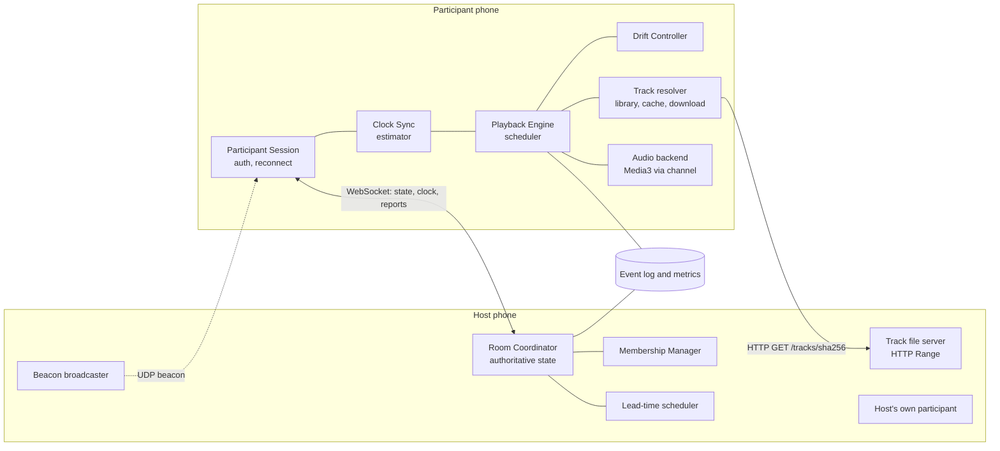
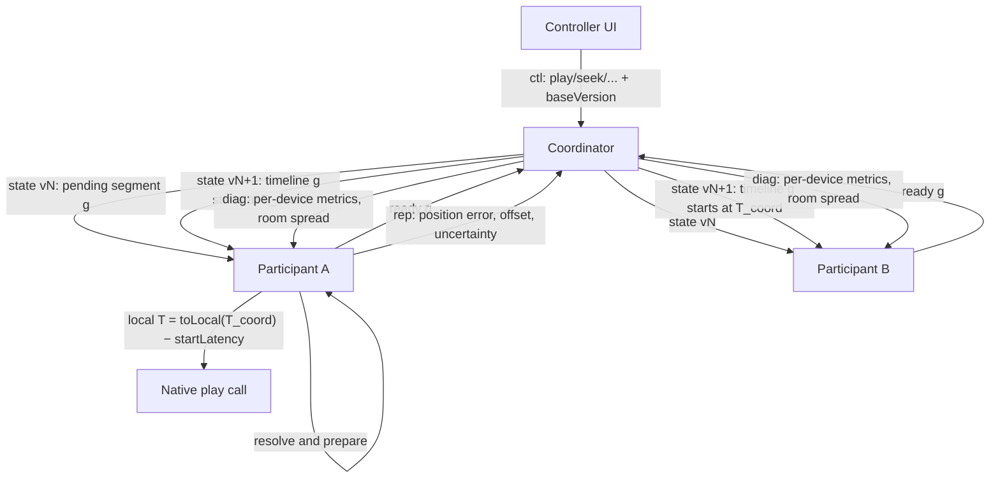

# SyncSphere architecture

SyncSphere makes several phones play the same music as close to simultaneously as the hardware allows.
Each phone decodes and renders audio itself. The system's job is to agree on **one playback timeline** and
make every phone render it in its own clock domain, despite unknown clock offsets, network delay,
audio-pipeline latency, drift, and failures.

- [Stack decision](#stack-decision)
- [Components](#components)
- [Data flow](#data-flow)
- [Room creation and synchronized start](#room-creation-and-synchronized-start)
- [The timeline model](#the-timeline-model)
- [Clock synchronization](#clock-synchronization)
- [Scheduling and start latency](#scheduling-and-start-latency)
- [Drift correction](#drift-correction)
- [Audio distribution](#audio-distribution)
- [Discovery and transport choices](#discovery-and-transport-choices)
- [Repository layout](#repository-layout)
- [Key technical risks](#key-technical-risks)
- [Milestones](#milestones)

Related documents: [protocol](protocol.md) · [state machines and sequences](state-machines.md) ·
[Android audio](android-audio.md) · [benchmarking](benchmarking.md) · [threat model and limitations](threat-model.md) ·
[roadmap](roadmap.md) · [troubleshooting](troubleshooting.md).

## Stack decision

The requested stack was kept: **Flutter/Dart** for UI and shared logic, **Media3/ExoPlayer** for Android playback
behind a **platform channel**, **Riverpod** for state, **WebSockets** for control traffic, and **SQLite** for local data.
The design separates out the parts where Dart cannot meet the timing requirement:

| Concern | Where it runs | Why |
|---|---|---|
| Protocol, coordinator, clock filtering, drift control, scheduling decisions | Pure Dart package `syncsphere_core` | Platform independent and fully testable in the cloud, including a virtual-time simulator. Timing here only needs to be ~1 ms accurate. |
| The actual play call at a target instant, position sampling, rate changes | Kotlin, on a dedicated `THREAD_PRIORITY_URGENT_AUDIO` thread | A Dart `Timer` runs on the UI isolate's event loop and can be delayed by frames or garbage collection. The native side uses `Handler.postAtTime` plus a bounded busy-wait on `System.nanoTime()`. |
| Decoding and output | Media3/ExoPlayer | Mature decoder support, pitch-preserving speed changes, and positions derived from `AudioTrack` timestamps. |

No Flutter timer is used to trigger audio. Dart decides *when*; Kotlin executes the play call at that instant.
Dart then measures the outcome and corrects.

A fully native Android app would remove the platform-channel hop. That hop is irrelevant here, though: play calls
are scheduled ahead of time and position samples carry their own native timestamps. The hop's latency therefore
never enters the timing budget, and the evidence did not justify changing stacks.

## Components



| Logical component (spec §4) | Implementation |
|---|---|
| 1. Room Coordinator | `coordinator/room_coordinator.dart`: versioned `RoomState`, generations, readiness barrier, authorization, heartbeats, auto-advance. |
| 2. Playback Participants | `participant/participant_session.dart` and `participant/playback_engine.dart`, plus an `AudioBackend` (`syncsphere_audio` on Android). |
| 3. Clock Synchronization | `time/clock_sync.dart` (estimator), the probing loop in the session, and `time/clock_domain_bridge.dart` (Dart ↔ native). |
| 4. Playback Scheduler | `coordinator/lead_time.dart` (target time) and `PlaybackEngine._activate`/`_lateJoin` (local execution). |
| 5. Drift Monitor | `PlaybackEngine._measure` (error measurement) and `participant/drift_controller.dart` (decisions). |
| 6. Membership Manager | `coordinator/membership.dart`. |
| 7. Audio Distribution | `distribution/` (hashing, HTTP server, resumable downloader, cache, resolver). |
| 8. Observability | `observability/event_log.dart` and `stats.dart`, sync reports, the diagnostics broadcast, and the simulator's ground-truth metrics. |

Each component sits behind an interface (`MessageConnection`, `AudioBackend`, `TrackResolver`, `MonotonicClock`),
so the simulator, the CLI and the app can swap implementations.

## Data flow



## Room creation and synchronized start

```mermaid
sequenceDiagram
  autonumber
  participant H as Host app
  participant C as Coordinator (on host)
  participant P as Participant
  participant N as Participant native audio
  H->>C: create room (roomId, join key; key derived with PBKDF2)
  C-->>P: UDP beacon {room, name, port}
  P->>C: hello {deviceId, nonce, caps}
  C->>P: challenge {serverNonce, kdf, instance}
  P->>C: auth {HMAC proof}
  C->>P: welcome {session, role, config, state, serverProof} (MAC'd)
  loop burst, then every 1–3 s
    P->>C: clk.req {t1}
    C->>P: clk.res {t1, t2, t3}
  end
  H->>C: ctl play (baseVersion)
  C->>P: state: pending g=1 (track, position)
  P->>P: resolve track (local by SHA-256, or download), prepare standby player
  P->>C: ready g=1 {rttP95, startLatency, uncertainty}
  C->>C: barrier complete → lead = f(measured RTT, latency, uncertainty)
  C->>P: state: timeline g=1 playing, anchor at T (coordinator time)
  P->>N: startAt(T_local − startLatency)
  N-->>P: playCalled(actual time)
  P->>P: after settle: measure position vs timeline, learn latency, correct drift
  P->>C: rep {error, offset, uncertainty, mode}
```

## The timeline model

All playback state reduces to a linear function from coordinator time to track position:

```
expectedPosition(t_coord) = anchorPosition + (t_coord − anchorCoordTime) × rate     (status = playing, t ≥ anchor)
```

A start, pause, resume, seek or track change creates a new timeline with a new **generation** and an anchor in the future.
Each device renders the same function after converting coordinator time into its own clock domain. So:

- No device ever receives a "play now" command; a late command only costs a mid-stream join.
- A reconnecting device needs only the current state and a clock estimate to work out exactly where it should be.
- Stale messages are harmless. State snapshots carry a monotonically increasing `version`, and everything playback-related
  carries its `generation`.
- While the coordinator is unreachable, participants keep rendering the last timeline, extrapolating their clock estimate
  with the measured skew.

## Clock synchronization

Implemented in `ClockSyncEstimator` and documented in its source.

- **Exchange:** NTP-style four timestamps. Probes are initiated by the participant (the side that needs the offset).
  The formula is the standard `θ = ((t2 − t1) + (t3 − t4)) / 2`, where θ is the responder minus the initiator.
- **Clock domains:** every timestamp is a *monotonic* microsecond counter (`Stopwatch`, which is CLOCK_MONOTONIC on
  Android). Wall-clock time is only used in human-readable logs. The coordinator's clock domain is identified by an
  `instance` id; if that changes (the process restarted), participants discard all samples. On Android, a second bridge
  maps the Dart monotonic clock to `System.nanoTime()` by bracketing native reads between Dart reads.
- **Asymmetry:** with forward delay `df` and return delay `db`, the error is `(df − db)/2`, which cannot be observed.
  One sample therefore only proves `θ ∈ [t3 − t4, t2 − t1]`, an interval whose width is the round-trip delay. Wi-Fi
  power save makes downlink delay spiky, which is why the app holds a low-latency `WifiLock`.
- **Filtering:**
  1. Samples are rejected if malformed, if the RTT exceeds the limit, or if they are too old.
  2. Each interval is projected to a common reference time using the estimated skew, and widened by the skew
     uncertainty times its age.
  3. **Marzullo's algorithm** keeps the region agreed on by most samples, which rejects outliers.
  4. The estimate is the midpoint of that region; the uncertainty is its half-width, with a 50 µs floor.
- **Skew:** a weighted least-squares fit over the minimum-delay sample in each of 8 time buckets. It starts after
  20 s and 10 samples. Until then, the uncertainty grows at the configured worst case of 200 ppm.
- **What the uncertainty means:** it is a bound that holds as long as one-way delays are non-negative and skew stays
  within its bound. In the simulated suite, the true offset lay inside the reported interval in ≥ 99.9 % of samples.
  The bound is conservative: on a link whose one-way delay is ≥ 2 ms, no exchange can prove better than about ±2 ms.
  For example, simulated `wifi-good` reported a median of ±2.4 ms against an actual p95 error of 0.4–0.8 ms.

## Scheduling and start latency

The coordinator chooses the start time once every participant in the barrier has acknowledged `ready`:

```
lead = max over ready participants (rttP95 × 1.5 + startLatency + clockUncertainty) + 120 ms safety,
       clamped to [250 ms, 3 s]
```

Every term is reported by participants (`ready`/`rep`). The 250 ms floor covers platform-channel and event-loop jitter.

Three moments are kept distinct throughout the code and the UI:

1. **Command receipt.** The participant applies the state containing the future anchor.
2. **Play call.** Native code calls `ExoPlayer.play()` at `T_local − startLatency`. It reports `playCalled` with the
   actual `System.nanoTime()`.
3. **Audible output.** This is never observed directly. It is inferred about 1.2 s later from ExoPlayer's
   `AudioTrack`-timestamp-based position, as the start error.

`startLatency` begins at the platform hint (two mixer buffers plus 30 ms), or at the value persisted from the last session.
After each start it moves 60 % of the way toward the measured error. In simulation this took first-start errors from
50–80 ms down to a few milliseconds.

## Drift correction

Devices drift for two separate reasons. Their system clocks run at slightly different rates; the clock estimator's skew
term handles this. Separately, each device's audio clock (DAC crystal) drifts relative to its own system clock; the drift
controller handles this. `DriftController` runs on each participant, so the control loop never waits on a network round
trip:

| Mode | Enter | Leave | Action |
|---|---|---|---|
| in sync | \|e\| ≤ 8 ms | — | Rate 1.0. |
| rate correcting | \|e\| > 8 ms | \|e\| < 3 ms (hysteresis) | `rate = 1 − e / 4 s`, clamped to ±1.5 %, in 0.05 % steps, pitch preserved. |
| resync | \|e\| − clockUncertainty > 250 ms for 2 consecutive filtered samples (45 ms without rate control) | When the resync completes | Prepare a standby player at the position that will be due, then switch at a scheduled instant. 5 s cooldown between seeks. |

Measurements are median-filtered over 5 samples and taken every 0.5 s while correcting (every 2 s when in sync).
Tiny errors therefore never cause a seek, and a seek can never be justified by an uncertain clock.

## Audio distribution

- **Identity:** a track's id is the SHA-256 of its bytes. Size is used as a preliminary filter. Metadata never decides
  a match.
- **Matching local files** (`localOnly`): each device indexes its imported files by hash, reports availability per
  track, and the room screen shows `n/m devices`.
- **Host-provided LAN audio** (`auto`, `lanOnly`): participants download `GET /tracks/<sha256>` from the host's HTTP
  server before playback. Requests are authorized with a per-session HMAC token and resume with `Range` requests.
  Every download is verified against the hash and kept in an LRU cache. The next track is prefetched. Playback never
  streams from the network, so Wi-Fi hiccups cannot cause buffer underruns.
- **Live streaming** (for example, microphone input) is out of scope. It would need its own jitter buffer
  ([roadmap](roadmap.md)).

## Discovery and transport choices

| Option | Verdict |
|---|---|
| **UDP broadcast beacons** | **Used.** Same code everywhere, works on most home routers and on Android hotspots once a `MulticastLock` is held. The beacon carries no secrets. |
| mDNS/DNS-SD | A standards-based alternative (Android `NsdManager`). Multicast is often filtered on consumer APs. Listed on the roadmap as an additional channel. |
| Manual `host:port` | Always available. It is the only option under AP client isolation. |
| **WebSocket over TCP** | **Used** for control: ordered, reliable and framed, and served from the same port as file transfer. TCP retransmissions only inflate the RTT of the affected clock samples, and the interval filter discards those. |
| UDP for clock probes | Would avoid TCP head-of-line blocking. Optional future transport behind the same estimator. |

Discovery (UDP), control (WebSocket) and bulk audio (HTTP) are deliberately separate, so a large download never queues
in front of a clock probe.

## Repository layout

```
packages/syncsphere_core/   pure Dart: protocol, clock sync, coordinator, participant, drift,
                            distribution, discovery, simulation; CLI tools in bin/
packages/syncsphere_audio/  Flutter plugin: Kotlin Media3 engine + Dart AudioBackend
app/                        Flutter app (Riverpod, sqflite, 4 screens)
benchmarks/results/         committed raw + summary results (simulated, clearly labelled)
tools/                      analysis scripts (Python stdlib only)
docs/                       this documentation
.github/workflows/ci.yml    analyze, test, benchmark, APK build
```

## Key technical risks

| Risk | Mitigation | Status |
|---|---|---|
| ExoPlayer start latency varies per device and per start | Learned compensation, then closed-loop correction | Implemented. Needs real-device validation. |
| Reported position ≠ acoustic output (Bluetooth, DSP) | Per-device calibration offset; flagged in the UI | Offset implemented; measuring it needs a microphone ([roadmap](roadmap.md)) |
| Wi-Fi power save and asymmetry | Low-latency WifiLock, min-delay filtering, honest uncertainty | Implemented |
| Rate changes audible on some content | ±1.5 % cap, pitch preserved, dead band | Configurable |
| VBR MP3 seek inaccuracy | Media3 index seeking enabled | Implemented |
| Background restrictions or Doze stop playback | Screen kept on while in a room | A foreground service is on the [roadmap](roadmap.md) |
| Coordinator loss | Detection, free-running playback, bounded reconnect, explicit "room needs to be recreated" message | Implemented. Automatic failover is a separate milestone ([roadmap](roadmap.md)). |
| No Android SDK in the development container | GitHub Actions builds the APK and runs the Kotlin tests | See README |

## Milestones

| Phase | Content | State |
|---|---|---|
| 1 | Architecture and protocol design | Done (this document set) |
| 2 | Minimal end-to-end: room, join, clock sync, scheduled start, pause and resume, diagnostics | Done: core, app and plugin. Real phones not yet tested. |
| 3 | Multi-sample clock estimation with uncertainty, readiness barrier, scheduled seek, drift monitoring and correction, reconnection, generations and versions | Done (unit, simulation and real-socket tests) |
| 4 | Hash verification, availability, LAN delivery, cache, resume | Done (tests over loopback HTTP) |
| 5 | Membership, malformed input, timeouts, coordinator loss, authorization | Done (tests) |
| 6 | Benchmarks | Simulated harness and results done. Real-device protocol written; real-device data still to collect. |
| 7 | Acoustic calibration, spatial audio, adaptive intervals, failover | Partly: calibration offset and adaptive probing exist. See the [roadmap](roadmap.md). |
