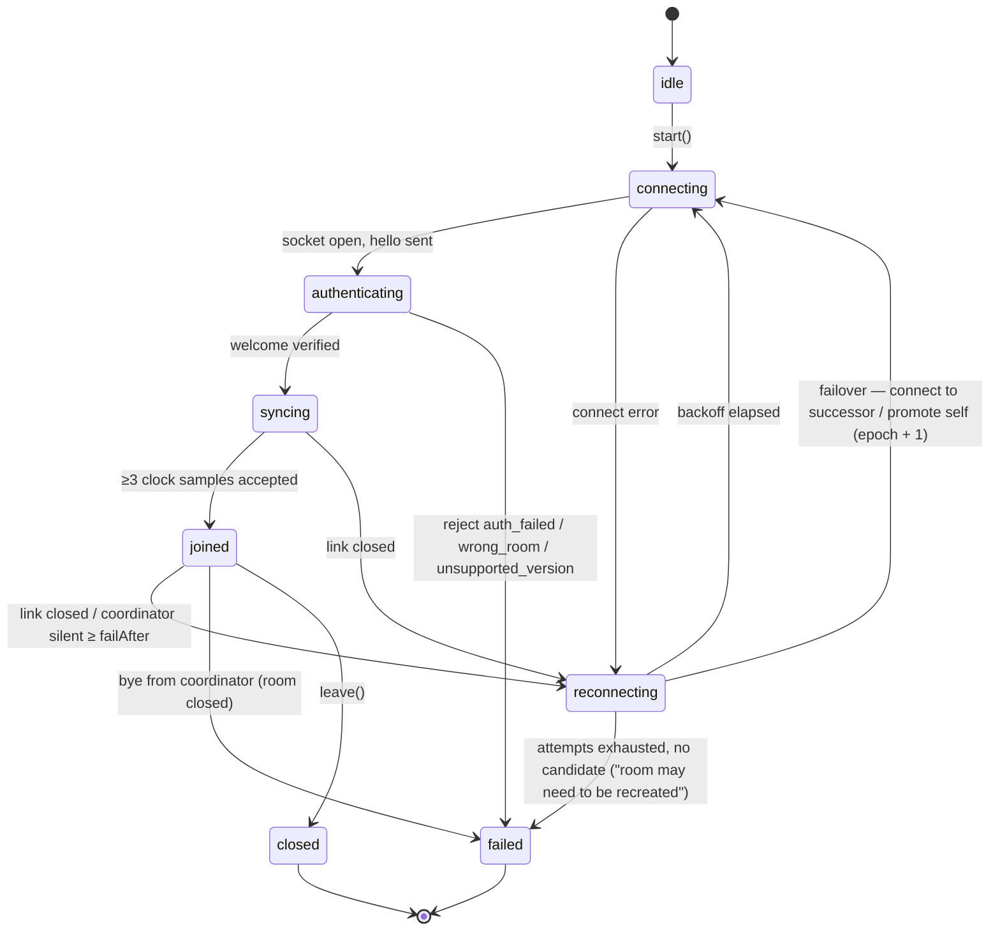
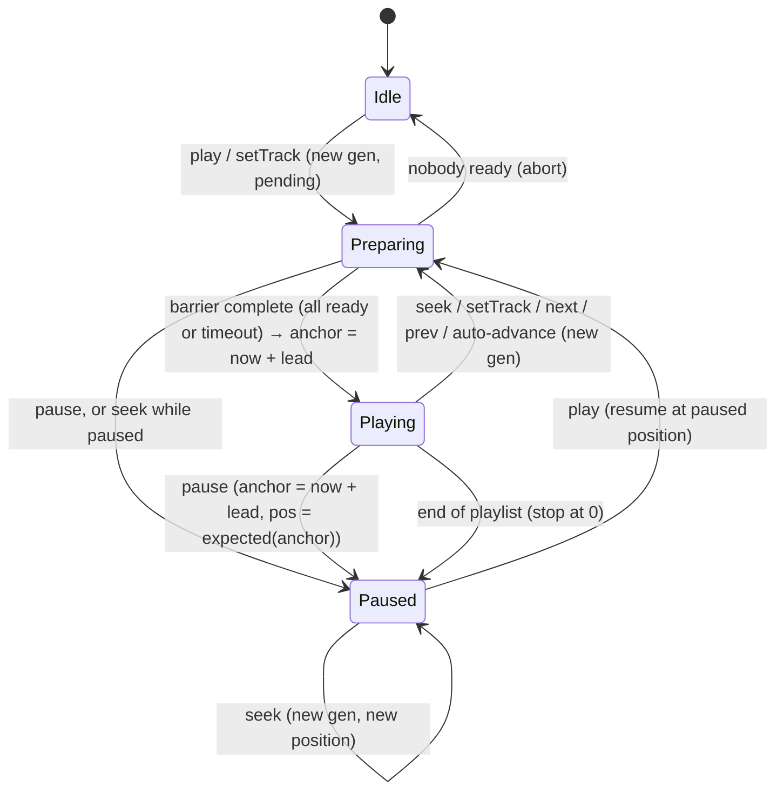
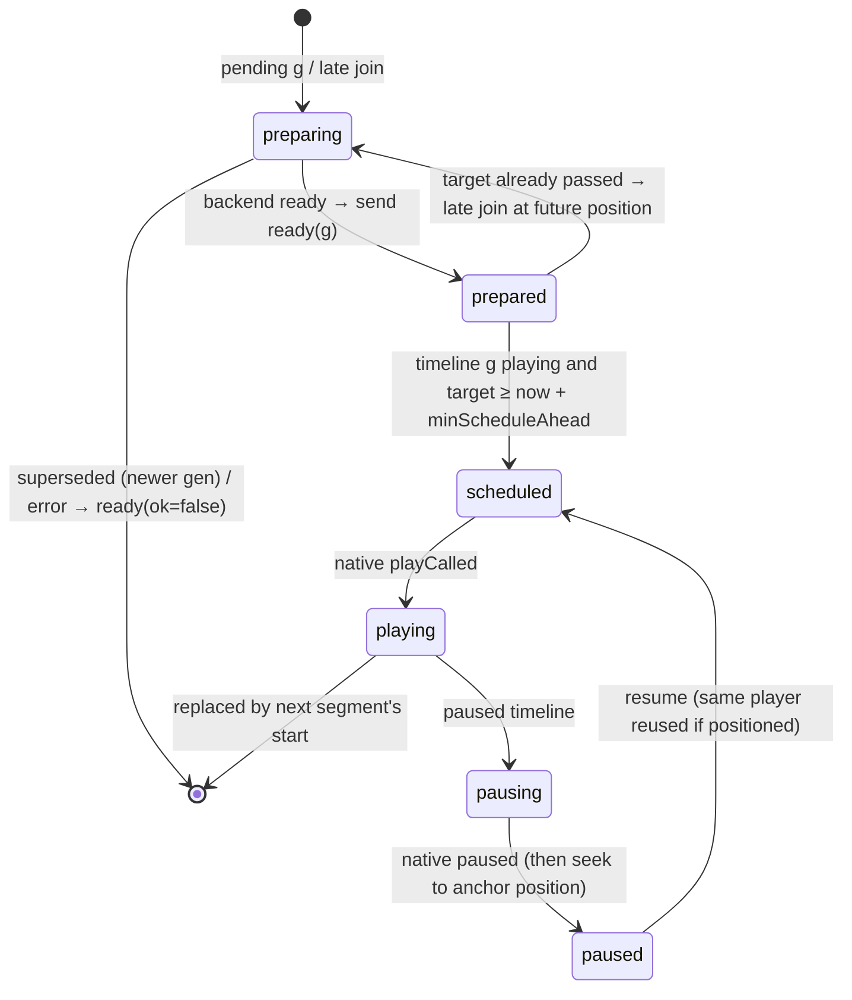
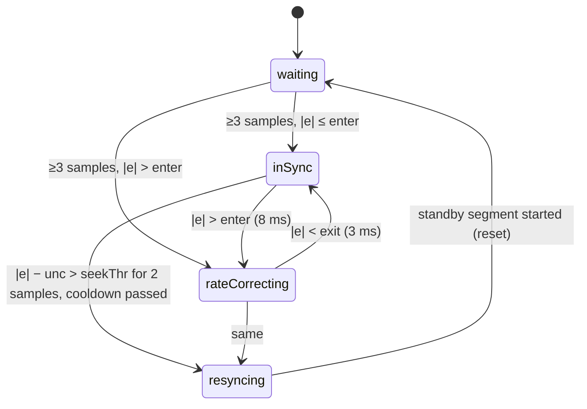
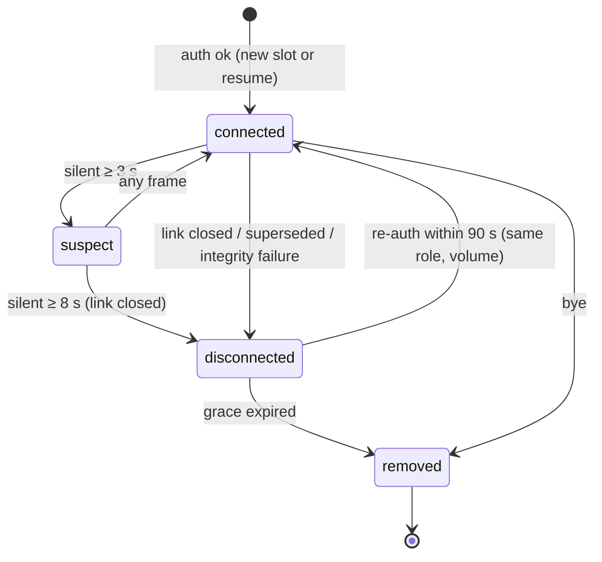

# State machines and sequence diagrams

## Participant session (connection lifecycle)



Invariants:
- Control requests are only sent in `syncing` or `joined`. In any other phase they fail locally with `not_connected`.
- Playback continues in `reconnecting`, following the last timeline.
- A change of coordinator instance (`challenge.inst`) discards all clock samples.

## Coordinator playback state



Every transition increments `version`. Every transition except a pure membership or volume change also increments
`generation` (the Idle state has generation 0).

## Participant playback engine (per segment)



## Drift controller



`e` is the median of the last 5 measurements. Without rate control there is no `rateCorrecting` state, and the seek
threshold is 45 ms instead of 250 ms.

## Membership (coordinator view of one device)



## Sequence: pause, resume and seek

```mermaid
sequenceDiagram
  autonumber
  participant U as Controller
  participant C as Coordinator
  participant A as Participant A
  participant B as Participant B
  U->>C: ctl pause (base v)
  C->>C: P = now + lead; pos = expected(P); gen+1
  C-->>A: state: paused @P pos
  C-->>B: state: paused @P pos
  A->>A: pauseAt(local(P)) then seek(pos)
  B->>B: pauseAt(local(P)) then seek(pos)
  U->>C: ctl play
  C-->>A: state: pending g+2 at pos
  C-->>B: state: pending g+2 at pos
  A->>C: ready (reused paused player)
  B->>C: ready
  C-->>A: state: playing g+2 @T
  C-->>B: state: playing g+2 @T
  U->>C: ctl seek 2:00 (base v')
  C-->>A: state: pending g+3 at 120 s
  C-->>B: state: pending g+3 at 120 s
  Note over A,B: standby players buffer at 120 s while g+2 keeps playing
  A->>C: ready
  B->>C: ready
  C-->>A: state: playing g+3 @T'
  C-->>B: state: playing g+3 @T'
  Note over A,B: at local(T') the standby starts and the old player is paused/released
```

## Sequence: reconnection

```mermaid
sequenceDiagram
  autonumber
  participant P as Participant
  participant C as Coordinator
  Note over P: Wi-Fi drops. Audio keeps playing on the last timeline.
  C->>C: silent 3 s → suspect; 8 s → disconnected (slot kept 90 s)
  P->>P: silent 8 s → link down → backoff 0.5, 1, 2, … s
  P->>C: hello / auth (same deviceId, resume=session)
  C->>P: welcome {current state vN}
  P->>C: clk.req burst
  alt same generation still playing
    P->>P: keep active segment; drift loop corrects small offset
  else timeline changed while away
    P->>P: late join: prepare at expected(now + lead), start at exact time
  end
  P->>C: evt rejoined {recoveryUs, errorUs}
```

## Sequence: coordinator loss and failover

```mermaid
sequenceDiagram
  participant C as Coordinator (host, epoch 1)
  participant A as Guest A (candidate #0)
  participant B as Guest B
  C--xA: host crashes (or leaves Wi-Fi: detected after 8 s of silence)
  C--xB: link lost
  A->>A: free-run on last timeline; after failoverAfter (2 s): candidate #0 is me
  A->>A: translate timeline: anchor_A = toLocal(anchor_C); keep generation; epoch 2
  A->>A: start coordinator (same room id and key), serve tracks, beacon
  A->>A: own session joins via loopback (audio keeps playing)
  B->>B: after 2 s: candidate #0 is A
  B->>A: hello / auth (same key)
  A->>B: welcome {state epoch 2, same generation}
  B->>B: discard old clock samples, new burst; keep active segment
  B->>A: evt rejoined
```

If no candidate exists (or failover is disabled), participants retry with backoff for ~3–4 minutes and then report
"coordinator unreachable; the room may need to be recreated".
